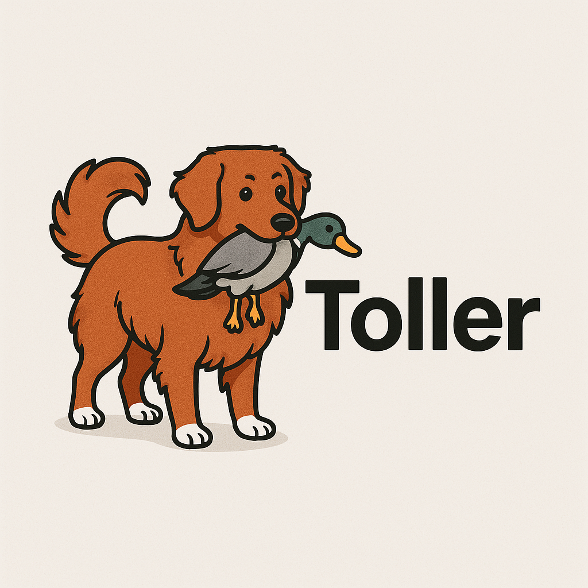

<p align="center">
  
</p>

## What is Toller?

Toller is a fast, dependency-free linter that finds what AI coding agents leave in your comments: ticket
keys, tracker links, edit-history notes, step-by-step narration, placeholders, chat leftovers, and references
to code that no longer exists. It removes the ones it can safely remove, and it hands the rest to an agent
in a form the agent can fix.

A [Nova Scotia Duck Tolling Retriever](https://www.akc.org/dog-breeds/nova-scotia-duck-tolling-retriever/)
finds things and brings them back. Toller finds the comments that only made sense in the PR that added them
and brings them to you before they go stale.

```ts
// PROJ-33: switch to the cached client.         ← ticket-ref
// Now uses the cached client instead of fetch.  ← changelog
// Same guard as renderHeader.                   ← dangling-ref (renderHeader was deleted)
const client = getCachedClient();
```

## Why Toller?

Coding agents write comments for the conversation they are in, not for the next reader. A comment such as
`(PROJ-1583 decision)`, `This used to be a global cache`, or `Step 2: normalize input` describes the
change, not the code. The commit message and the PR already record the change. In the code, the comment only
goes stale, and a ticket key points readers outside the team at a tracker they cannot open.

## What makes Toller different

**It targets provenance, not prose.** Other "AI slop" linters look for generated prose: "robust",
"seamless", "delve". When we audited 45,000 comment lines in an agent-written codebase, those words were
almost absent. What agents actually write is **provenance**: pointers to tickets, design files, plan
slices, reviewers, and earlier versions of the code. Toller is built for that.

**It needs no config.** Toller reads your git history to learn which tracker prefixes your team uses. A
prefix counts when branch names or commit messages use it with at least 5 different numbers, so it knows
that `ENG-2122` is a ticket and that `UTF-8`, `SHA-256`, and `round-2` are not.

**It fixes, and it proves that the fix changed only comments.** `--fix` removes a ticket key when the
sentence stays correct without it. After each file, Toller lexes the result again and cancels the edit if
any byte outside the comments changed. It keeps each file's line endings, CRLF included.

**It knows grammar.** Removing a key is easy; leaving a correct sentence is not. When a key starts a line
that continues a sentence, Toller moves the punctuation that followed it to the line above. It leaves a key
alone when the sentence needs it ("since PROJ-12 shipped"), when the key is quoted as an example
(`grep "PROJ-12"`), or when the line would still mention "the ticket". These rules come from reviewing
about 1,400 real edits in two codebases, round after round, until the reviewed edits had no wrong ones.

**It hands the hard part to an agent in a clean form.** Some keys are part of a sentence, and only a
writer can remove them. `--format jsonl` gives one task per comment block, with the block's exact file
text, so an agent can rewrite it with one exact string replacement. [AGENT_PROMPT.md](AGENT_PROMPT.md) is
a prompt for that job, tested with a small, cheap model.

**It knows what a diff deleted.** In diff mode, Toller flags comments anywhere in the repo that name a
symbol the diff removed, even comments the diff did not touch. A rename no longer leaves stale
`mirrors renderHeader` comments behind.

**It is fast.** Toller is one Go binary with no dependencies. With every rule on, it checks 3,700 files in
about 1 second and 12,500 files in under 2 seconds. Without `dangling-ref`, which builds a symbol index of
the whole repo, the 3,700-file run takes about 0.3 seconds.

## Tested on real code

| Codebase | Ticket refs | Removed by `--fix` | Review of the fixes | Code changed |
| --- | --- | --- | --- | --- |
| Production TypeScript/Vue app, 3,700 files | ~1,950 | 1,483 lines | 1,000 sampled edits: 0 wrong after tuning | 0, by a full TypeScript parse of every changed file; lint, format, and typecheck pass |
| Production C# and SQL API, 12,000 files, CRLF | 650 | 360 lines | All 361 edits: 0 wrong | 0, by a Roslyn token compare; line endings unchanged |
| Small TypeScript app, no keys in git history | 33 | 24 lines | All 24 read by hand: 0 wrong | 0, by a full TypeScript parse |

The keys that `--fix` leaves behind are part of a sentence. In a trial on 43 of those comment blocks, a
small model removed every key with the prompt in [AGENT_PROMPT.md](AGENT_PROMPT.md), and it changed no code.

We also ran Toller on ten well-known open-source TypeScript projects. Three had between 76 and 3,900
comment blocks with internal ticket keys. One of them already forbids ticket keys in code comments in its
own agent instructions, and it still had more than 480. A written rule does not stop agents; a check does.

## Install

```sh
brew install --cask NolanTrem/tap/toller     # macOS and Linux
go install github.com/NolanTrem/toller@latest
```

Or download a binary for macOS, Linux, or Windows from the
[releases page](https://github.com/NolanTrem/toller/releases).

### pre-commit

With [pre-commit](https://pre-commit.com), Toller checks only the comment lines you are about to commit:

```yaml
# .pre-commit-config.yaml
repos:
  - repo: https://github.com/NolanTrem/toller
    rev: v0.1.1
    hooks:
      - id: toller
```

### GitHub Actions

Fail a pull request that adds a ticket key, a tracker link, or an edit-history note. Toller checks only the
lines the PR adds, so old comments do not block anyone:

```yaml
toller:
  runs-on: ubuntu-latest
  if: github.event_name == 'pull_request'
  steps:
    - uses: actions/checkout@v6
      with:
        fetch-depth: 0 # Toller learns the ticket prefixes from commit messages and branch names
        filter: blob:none
    - uses: actions/setup-go@v6
      with:
        go-version: stable
        cache: false
    - run: go install github.com/NolanTrem/toller@v0.1.1
    # HEAD is the PR merged into the base branch, so HEAD^1 is the base.
    - run: '"$(go env GOPATH)/bin/toller" --diff HEAD^1'
```

### Claude Code

Catch the comment while the agent is still writing it. This hook runs Toller on each file the agent
edits, checks only the lines that are new since the last commit, and gives any findings back to the agent
so it fixes them in the same turn:

```json
{
  "hooks": {
    "PostToolUse": [
      {
        "matcher": "Edit|Write|MultiEdit",
        "hooks": [
          {
            "type": "command",
            "command": "f=$(jq -r '.tool_input.file_path // empty'); [ -n \"$f\" ] || exit 0; out=$(toller -q --diff HEAD \"$f\" 2>&1) || { echo \"$out\" >&2; exit 2; }"
          }
        ]
      }
    ]
  }
}
```

Put it in `.claude/settings.json` in your repo. It needs `toller` and `jq` on your `PATH`.

## Usage

```sh
toller                       # whole repo (honors .gitignore)
toller --staged              # only lines added in the index (pre-commit hook)
toller --diff origin/main    # only lines added since a ref (CI)
toller --prefixes PROJ,WEB   # override the ticket prefixes detected from git
toller --ref-index ../api,node_modules   # symbols in other repos and package types count as known
toller --version
```

Exit code: `0` clean, `1` findings, `2` error. To suppress one comment, add `toller:ignore` to it.
Toller skips generated files: files with a `Code generated … DO NOT EDIT`, `@generated`, `<auto-generated>`,
`AUTO-GENERATED FILE`, or `DO NOT EDIT` comment in their first 1 KB. The fix belongs in the generator.

If the git history has no ticket prefixes, Toller flags any `KEY-123` except known standards, and it tells
you which prefixes your comments use. To set the prefixes once, put the flags in a `.toller` file at the
repo root, one or more per line. Flags on the command line win.

```sh
# .toller
--prefixes PROJ,WEB
```

## Fixing

```sh
toller --fix --dry-run       # print each proposed change as JSON; write nothing
toller --fix                 # remove the ticket keys that can go without rewording
toller --format jsonl        # one task per comment block, for an agent to reword
```

`--fix` removes a key in a parenthetical `(PROJ-50)`, a label `PROJ-33: `, or a comment that holds only a
key. It runs again until nothing changes, so `PROJ-1 (PROJ-2): text` becomes `Text`. It skips files with unstaged changes, so `git diff` shows exactly what it did. Without prefixes from
git or `--prefixes`, it uses only a prefix that the comments use with at least 5 different numbers.

## Rules

| ID | Flags |
| --- | --- |
| `ticket-ref` | `PROJ-123`-style keys. Skips standards (`UTF-8`, `SHA-256`, `ISO-8601`, `UTC-5`, `DNS-1123`…), regex ranges, zero-padded IDs, and quoted examples. |
| `tracker-url` | Linear, Jira, and Shortcut links, and GitHub issue or PR links to this repo. A link to another repo's issue is allowed, because it usually explains a workaround. |
| `changelog` | `Added:`, `Changed from X to Y`, `Now uses…`, `used to be`, `was previously` |
| `narrator` | `Step 1:`, `Let's…`, `Here we…`, `Now we…` |
| `placeholder` | `... existing code ...`, `In a real implementation`, `simplified version` |
| `chat-leftover` | `As requested`, `You're absolutely right`, `I've updated…` |
| `dangling-ref` | `` `fooBar` `` or `mirrors FooBar` when no code defines `fooBar`. In diff mode, it also flags comments the diff did not touch that name a symbol the diff deleted. |

Toller checks only comments. A small lexer for each language skips strings, template literals, and JS regex
literals, so `"https://…"` and `/[A-Z0-9]/` never match.

## License

MIT
